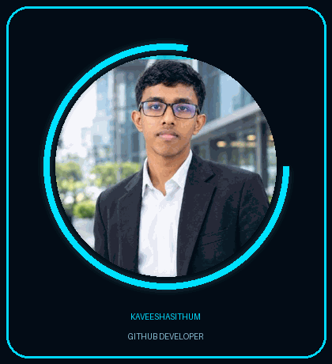

 
<div align="center">

# 👋 HELLO, WORLD!


<br/>



<br/>


<br/>


</div>

---

## 👨‍💻 About Me

```java
public class Kaveesha {

    String name = "Kaveesha Sithum Nimsara Weththasinhe";
    int age = 21;

    String school = "Seethawaka Central College";
    String institute = "ICET";

    String mainLanguage = "Java";

    String[] skills = {
        "HTML",
        "CSS",
        "JavaScript",
        "SQL"
    };

    String goal = "Professional Software Developer";

    public void introduce() {
        System.out.println("Hello World!");
        System.out.println("Welcome to my GitHub Profile!");
    }
}
```

- 🎓 Studying at ICET
- 💻 Interested in Software Development
- ☕ Learning Java Programming
- 🌱 Improving my programming skills every day
- 🚀 Building projects and learning new technologies
- 🎯 My goal is to become a Professional Software Developer

---

## 🛠️ Technical Skills

### Programming Languages

<div align="center">


</div>

### Tools & Technologies

<div align="center">


</div>

---

## 💻 What I'm Working On

- Learning Java programming
- Practicing problem solving
- Improving HTML and CSS skills
- Learning JavaScript
- Working with SQL databases
- Developing personal projects

---

## 🚀 My Projects

<div align="center">

<a href="https://github.com/kaveesithum?tab=repositories">

</a>

</div>

---

## 📊 GitHub Statistics

<div align="center">


<br/>


</div>

---

## 🐍 Contribution Snake

<div align="center">


</div>

---

## 🎓 Education

| Institution | Details |
|---|---|
| 🏫 School | Seethawaka Central College |
| 🎓 Institute | ICET |

---

## 📫 Connect With Me

<div align="center">

<a href="https://github.com/kaveesithum">

</a>

<a href="mailto:kaveesithum200604@gmail.com">

</a>

<a href="https://www.linkedin.com/in/kaveesha-sithum-nimsara-weththasinhe-83aa96414/">

</a>

</div>

---

<div align="center">

## ⚡ CODE. CREATE. INNOVATE. REPEAT.


<br/><br/>

### 💙 THANK YOU FOR VISITING MY PROFILE!

**Keep Learning • Keep Building • Keep Growing**

</div>
