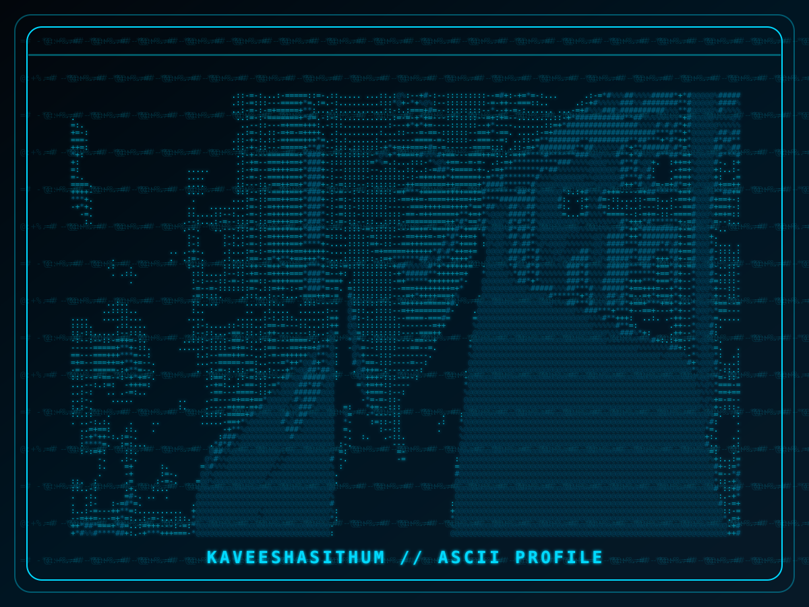

---

<table>
<tr>
<td width="35%" align="center" valign="top">

## 👨‍💻 ASCII PHOTO

**Kaveesha Sithum**

`@kaveeshasithum`

🎓 IT Student at iCET

☕ Java & SQL Learner

🚀 Software Developer

🇱🇰 Sri Lanka

</td>

<td width="65%" valign="top">

## 👋 Hi, I'm Kaveesha Sithum

### 💻 Aspiring Software Developer

## 👨‍💻 About Me

I'm an IT student interested in Java programming, database systems and modern web technologies.

* 🎓 IT Student at iCET
* ☕ Java & SQL Learner
* 🚀 Passionate about Software Development
* 🌱 Always Learning & Building

## 🛠️ Technologies & Skills

</td>
</tr>
</table>

---

## 💻 HACKER CODING MODE

---

## 📊 GITHUB STATISTICS

  

---

## 🐍 CONTRIBUTION SNAKE

---

## 👾 PACMAN CONTRIBUTIONS

<picture>
<source media="(prefers-color-scheme: dark)" srcset="https://raw.githubusercontent.com/kaveeshasithum/kaveeshasithum/pacman-output/pacman-contribution-graph-dark.svg?game=pacman">
<source media="(prefers-color-scheme: light)" srcset="https://raw.githubusercontent.com/kaveeshasithum/kaveeshasithum/pacman-output/pacman-contribution-graph.svg?game=pacman">

</picture>

---

## 🌐 CONNECT WITH ME

  

  

